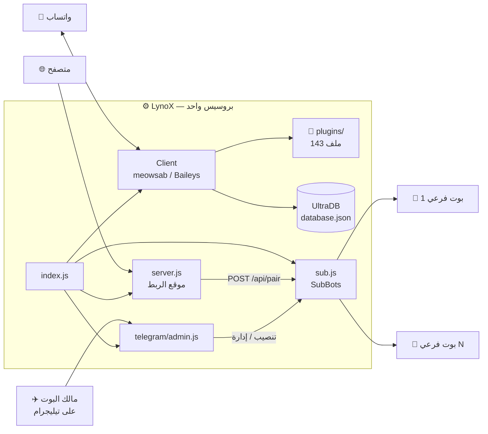
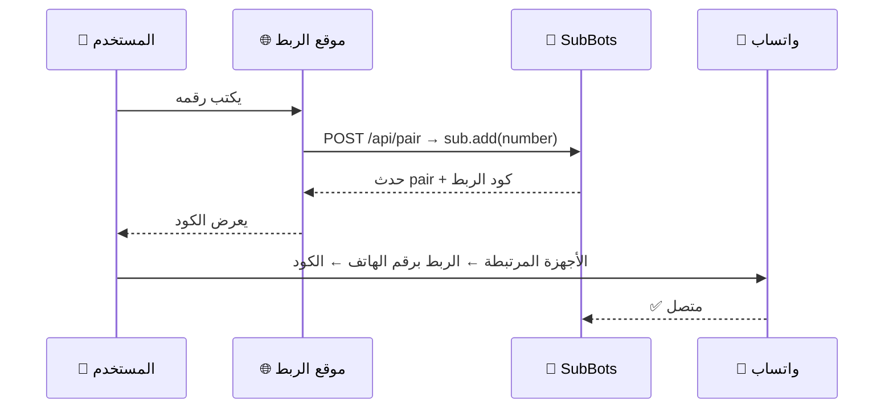

<div align="center">



<br/>


[](https://whatsapp.com/channel/0029Vb82Y93GehEEid2Xap23)
[](https://github.com/khaledfayed704-del)

**بوت واتساب عربي متكامل — 143 ملف أوامر في 18 قسم، بوتات فرعية، وبوت تيليجرام للتحكم**
مبني على Baileys بنظام Plugins: ضيف أمر جديد بمجرد ما تحط ملف في مجلد.

[✨ المميزات](#-المميزات) · [🚀 التثبيت](#-التثبيت) · [🔧 الإعدادات](#-الإعدادات) · [🤖 البوتات الفرعية](#-البوتات-الفرعية) · [✈️ تيليجرام](#️-لوحة-تيليجرام) · [🧩 اكتب أمر](#-اكتب-أمر-جديد) · [🔐 الأمان](#-الأمان)


</div>

<div dir="rtl">

## 🎯 ليه LynoX؟

<table>
<tr>
<td width="25%" align="center"><h3>🧩</h3><b>143 Plugin</b><br/><sub>أوامر مقسّمة على 18 قسم<br/>وقائمة تفاعلية بالأرقام</sub></td>
<td width="25%" align="center"><h3>🤖</h3><b>بوتات فرعية</b><br/><sub>أي حد يربط رقمه ببوت خاص<br/>من الأمر أو الموقع أو تيليجرام</sub></td>
<td width="25%" align="center"><h3>✈️</h3><b>لوحة تيليجرام</b><br/><sub>تنصيب وإدارة وإذاعة<br/>ونسخة احتياطية بزرار</sub></td>
<td width="25%" align="center"><h3>🎮</h3><b>ألعاب واقتصاد</b><br/><sub>شطرنج وXO وبنك<br/>وذكاء اصطناعي بشخصيات</sub></td>
</tr>
</table>

<div align="center"></div>

## 🧭 إزاي بيشتغل؟

كل حاجة بتشتغل جوه **نفس البروسيس** (`index.js`)، وده اللي بيخلّي الموقع وبوت تيليجرام يوصلوا للبوتات الفرعية مباشرة.



<div align="center"></div>

## ✨ المميزات

### 🧩 الأقسام والأوامر

اكتب `.عام` وبعدها **رد على الرسالة برقم القسم** — القائمة بتتبني تلقائيًا من الأوامر المحمّلة. وفيه عروض تانية للقائمة: `.اوامر` · `.menu` · `.m`.

| # | القسم | أمثلة من الأوامر |
|:--:|:--|:--|
| 1 | 📂 **التحميل** | `يوتيوب` · `اغنية` · `تيك` · `انستا` · `فيس` · `ميديافاير` · `سبوتيفاي` · `انمي` |
| 2 | 🐞 **المجموعات** | `زواج` · `طلاق` · `ماتشينج` · `توب` · `لينك` · `رابطي` · `قناة` · `سكريبت` |
| 3 | 🌄 **الملصقات** | `ملصق` · `نص` · `حقوق` · `باكج` |
| 4 | 🫦 **المطورين** | `رستارت` · `اذاعه` · `حظر` · `فك_حظر` · `اضافه_مطور` · `نسخة_البوت` · `انضم` · `اخرج` |
| 6 | 🚀 **الأدوات** | `لصوره` · `لصوت` · `لچيف` · `لفيديو` · `لرابط` · `تعديل` · `ocr` |
| 7 | 🌐 **البحث** | `بحث` · `بينترست` · `بحث_تيك` · `فيديو` |
| 8 | 👨🏻‍⚖️ **الأدمن** | `رفع` · `خفض` · `طرد` · `كتم` · `فك_كتم` · `قفل` · `فتح` · `انذار` · `منشن` · `تفعيل` |
| 9 | 🎮 **الألعاب** | `شطرنج` · `اكس` (XO) · `علم` · `عين` · `تفكيك` · `مسابقه` |
| 10 | ✴️ **الچيف** | `حضن` · `صفع` · `ارقص` · `ضحك` · `ابكي` · `مصافحه` · `باكا` |
| 11 | 💰 **البنك** | `تسجيل` · `يومي` · `اسبوعي` · `شهري` · `سرقة` · `بروفايل` |
| 12 | 🤖 **الذكاء الاصطناعي** | `لوفي` · `إيتاتشي` · `إيرن` · `ميكاسا` · `مارين` · `بومني` · `سيلفير` · `نصيحة` · `طبخ` |
| 13 | ♥️ **البوتات الفرعية** | `تنصيب` · `البوتات` · `حذف_بوت` · `اذاعة_فرعي` · `احصائيات_البوتات` |
| 14 | 🗃️ **معلومات البوت** | `بنج` · `الرام` · `معلومات` |
| 15 | 🫯 **الألقاب** | `لقب` · `الألقاب` · `حذف_لقب` · `متوفر` |
| 16 | 🎡 **اللوجوهات** | `عميق` · `رعب` وغيرها — مثال: `.عميق venom` |
| 17 | 📢 **تغيير الأصوات** | `فويس1` … `فويس30` — رد على رسالة صوتية (حتى 20 ثانية) |

> [!NOTE]
> أسماء الأوامر الفعلية في كل ملف عند `handler.command` — بعضها له أكتر من اسم (عربي وإنجليزي)، والبريفكس الافتراضي: `.` و `/` و `!`.

### 🛡️ إدارة المجموعات

- **الأدمن**: رفع / خفض / طرد / كتم / قفل / فتح / تغيير اسم ووصف وصورة الجروب / قبول الطلبات
- **التحذيرات**: `انذار` + `انذاراتي` + قائمة `الانذارات` محفوظة في قاعدة البيانات
- **مضاد الروابط**: بيحذف روابط الجروبات والقنوات أوتوماتيك من غير الأدمن
- **الترحيب**: تشغيل/إيقاف لكل جروب

<details>
<summary><b>⚙️ أوامر <code>.تفعيل</code> (إعدادات الجروب)</b></summary>
<br/>

| الأمر | الوظيفة |
|:--|:--|
| `.تفعيل تشغيل_الترحيب` / `ايقاف_الترحيب` | ترحيب بالأعضاء الجداد |
| `.تفعيل تشغيل_الادمن` / `ايقاف_الادمن` | البوت يرد على المشرفين فقط / الجميع |
| `.تفعيل مطور_فقط` / `مطور_عام` | يتفاعل مع المطورين فقط / الجميع |
| `.تفعيل تشغيل_مضاد_الروابط` / `ايقاف_مضاد_الروابط` | حذف أي رابط جروب/قناة |
| `.تفعيل ايقاف_خاص` / `تشغيل_خاص` | الخاص للمطورين فقط / للجميع |
| `.تفعيل ايقاف_الفرعي` / `تشغيل_الفرعي` | قفل / فتح تنصيب البوتات الفرعية |

</details>

### 🎮 ألعاب واقتصاد

شطرنج كامل (ملف واحد ~2800 سطر)، XO، تخمين الأعلام والعيون، وبنك فيه تسجيل ومكافآت يومية/أسبوعية/شهرية وسرقة وبروفايل ومستويات.

<div align="center"></div>

## 🚀 التثبيت

### المتطلبات

| | المطلوب | ليه؟ |
|:--:|:--|:--|
| 🟢 | **Node.js 18+** | المشروع ESM (`"type": "module"`) وحزمة `sharp` |
| 🎞️ | **ffmpeg** | تحويل الصوت والفيديو والملصقات (`fluent-ffmpeg`) |
| 🔧 | **git** | حزمة `meowsab` بتتنزّل من GitHub |

### الخطوات

```bash
# 1️⃣ تحميل المشروع
git clone https://github.com/khaledfayed704-del/<اسم-الريبو>.git
cd <اسم-الريبو>

# 2️⃣ تثبيت الحزم
npm install

# 3️⃣ عدّل index.js (رقم البوت + المالكين + تيليجرام) — شوف قسم الإعدادات

# 4️⃣ تشغيل
npm start
```

> [!IMPORTANT]
> عدّل **`index.js`** قبل أول تشغيل: رقم البوت في `phoneNumber`، وبيانات المالكين في `owners`. القيم الافتراضية فيه مجرد نصوص مكان (`'رقم البوت'`).

بعد التشغيل اربط رقم البوت بواتساب (**الأجهزة المرتبطة ← الربط برقم الهاتف**) من الكود اللي بيظهر في الكونسول.

<div align="center"></div>

## 🔧 الإعدادات

كل الإعدادات في `index.js` (مفيش ملف `.env`).

<details open>
<summary><b>📱 الواتساب</b></summary>
<br/>

| الإعداد | الوصف |
|:--|:--|
| `phoneNumber` | رقم البوت بكود الدولة |
| `prefix` | بريفكس الأوامر — الافتراضي `[".", "/", "!"]` |
| `owners` | مصفوفة المالكين: `{ name, jid, lid }` لكل واحد |
| `settings.noWelcome` | `true` لإيقاف الترحيب عالميًا |
| `commandsPath` | مجلد الأوامر — الافتراضي `./plugins` |

</details>

<details>
<summary><b>🎨 الهوية <code>config.info</code></b></summary>
<br/>

| الإعداد | الوصف |
|:--|:--|
| `nameBot` / `nameChannel` | اسم البوت واسم القناة |
| `idChannel` | آيدي قناة الواتساب (`...@newsletter`) |
| `urls.repo` / `urls.api` / `urls.channel` | روابط الريبو والـ API والقناة |
| `copyright.pack` / `copyright.author` | حقوق الملصقات |
| `images` | صور القوائم (واحدة منها تتختار عشوائي) |

</details>

<details>
<summary><b>✈️ تيليجرام</b></summary>
<br/>

| الإعداد | الوصف |
|:--|:--|
| `global.telegramAdminToken` | توكن البوت من [@BotFather](https://t.me/BotFather) |
| `global.telegramAdminEnabled` | `true` / `false` لتشغيل اللوحة |
| `global.telegramOwnerID` | آيدي حسابك (رقم فقط) من [@userinfobot](https://t.me/userinfobot) |

</details>

<details>
<summary><b>🌐 موقع الربط</b></summary>
<br/>

| الإعداد | الوصف |
|:--|:--|
| `SERVER_PORT` / `PORT` | بورت الموقع (متغير بيئة من البانل) — الافتراضي `3000` |
| `DOMAIN` في `server.js` | الدومين اللي بيظهر في الكونسول (للعرض فقط) |

</details>

<div align="center"></div>

## 🤖 البوتات الفرعية

أي شخص يقدر يربط رقمه ببوت خاص من 3 طرق:

| الطريقة | إزاي |
|:--|:--|
| 💬 **أمر واتساب** | `.تنصيب` |
| 🌐 **موقع الويب** | افتح الصفحة، اكتب رقمك بكود الدولة، واضغط **احصل على كود الربط** |
| ✈️ **تيليجرام** | `/تنصيب` أو `/install` |



- مهلة طلب الكود **120 ثانية**.
- المالك يقدر يقفل التنصيب كله بـ `.تفعيل ايقاف_الفرعي` (بيضبط `global.db.noSub`)، والموقع وقتها يرجّع رسالة "معطّل حاليًا".
- الجلسات المحفوظة بتتحمّل تلقائي عند كل تشغيل (`✅ Loaded N saved bots`).

<div align="center"></div>

## ✈️ لوحة تيليجرام

| الأمر | الوظيفة |
|:--|:--|
| `/start` | القائمة الرئيسية |
| `/تنصيب` · `/install` | تنصيب بوت فرعي (بيطلب الرقم وبيتحقق منه) |
| `/بوتات` · `/bots` | عرض البوتات الفرعية |
| `/النظام` · `/system` | إدارة النظام (للمالك فقط) |
| `/cancel` | إلغاء العملية الحالية |

**إدارة النظام (للمالك فقط):**
🗑️ مسح كل الجلسات · 🧹 مسح قاعدة البيانات · 🔄 إعادة تشغيل · 📦 نسخة احتياطية · 📢 إذاعة لكل المستخدمين — وكل عملية خطيرة بتطلب تأكيد.

> [!WARNING]
> لو `telegramOwnerID` ما اتحطش، أوامر الإدارة الخطيرة **بتتقفل** (والتنصيب بس يفضل شغال).

<div align="center"></div>

## 🧩 اكتب أمر جديد

حط ملف `.js` في أي مجلد جوه `plugins/` — بيتحمّل لوحده:

```javascript
// plugins/info/hello.js
const handler = async (m, { conn }) => {
  await conn.sendMessage(m.chat, { text: 'أهلاً من LynoX 👋' });
};

handler.command  = ['هلا', 'hello'];   // الأسماء (أو Regex)
handler.category = 'info';             // القسم في القائمة
handler.usage    = ['هلا'];            // يظهر في قائمة الأوامر
// handler.owner = true;               // للمالك فقط

export default handler;
```

<div align="center"></div>

## 📁 هيكل المشروع

```
LynoX/
├── 🚪 index.js              نقطة الدخول: الإعدادات + تشغيل كل الأنظمة
├── 🌐 server.js             موقع ربط البوتات الفرعية (/ و /api/pair)
├── 🤖 sub.js                نظام SubBots (تحميل الجلسات + أحداث الربط)
├── 📦 package.json
├── 🎨 core/
│   └── theme.js             رموز وفواصل وتنسيق الرسائل
├── ⚙️ system/
│   ├── control.js           أحداث الجروب + صلاحيات الأوامر
│   ├── UltraDB.js           قاعدة بيانات JSON بحفظ مؤجّل
│   ├── LYNOXcm.js           بناء الرسائل التفاعلية (أزرار / carousel)
│   ├── utils.js             أدوات مساعدة
│   ├── webpair.js           نسخة بديلة من موقع الربط
│   └── database.json        بيانات التشغيل (بتتولّد تلقائي)
├── ✈️ telegram/
│   └── admin.js             لوحة تيليجرام: تنصيب + إدارة المالك
└── 🧩 plugins/              143 ملف أوامر
    ├── admins/  ai/  auto/  bank/  download/  example/
    ├── game/  gif/  group/  guild/  info/  logo/
    ├── owner/  search/  sticker/  subs/  tools/  voices/
    └── chess.js  menu.js  menu2.js  owner.js  id.js  m3.js  post.js
```

<div align="center"></div>

## 🔐 الأمان

| | الحماية | التفاصيل |
|:--:|:--|:--|
| 👑 | **أوامر المالك** | أي أمر عليه `handler.owner = true` النظام بيرفضه تلقائي لغير المالكين (زي `eval` و`exec`) |
| ✈️ | **لوحة تيليجرام** | العمليات الخطيرة مقصورة على `telegramOwnerID` وبتطلب تأكيد |
| 🔗 | **مضاد الروابط** | حذف روابط الجروبات والقنوات من غير الأدمن والمالكين |
| 🌐 | **موقع الربط** | حد 1MB للطلب، تحقق من الرقم، ومهلة 120 ثانية |
| 🚫 | **الحظر** | `حظر` / `فك_حظر` للمستخدمين |

> [!CAUTION]
> قبل ما ترفع المشروع على GitHub: **شيل** توكن تيليجرام وأرقام المالكين من `index.js`، **وامسح/تجاهل** `system/database.json` (فيه بيانات جروبات ومستخدمين حقيقية) ومجلدات الجلسات. لو توكن اتسرّب، غيّره من @BotFather فورًا.

<div align="center"></div>

## 🙏 شكر وتقدير

- [**Baileys**](https://github.com/WhiskeySockets/Baileys) — مكتبة واتساب
- **meowsab** — طبقة الأوامر والبوتات الفرعية
- **NIXCODE / Nixel** — مكتبة بناء الرسائل التفاعلية (`system/LYNOXcm.js`)، والواترمارك بتاعها لازم يفضل زي ما هو

<div align="center">


### 📄 الترخيص: [MIT](LICENSE)

صُنع بكل 💚 بواسطة **Lynox X**

[](https://wa.me/@WND0)

⭐ لو المشروع عجبك، سيب نجمة على الريبو

</div>

</div>
